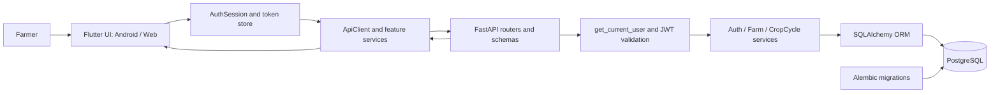
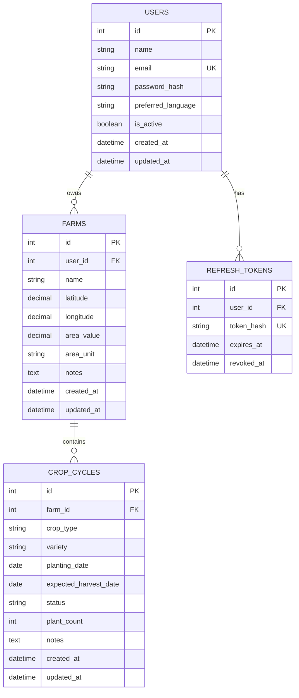

# AgroCrew Project Handover

**Purpose:** give a new developer or AI assistant a source-based overview of the repository, current implementation, verification evidence, and next work.

**Repository checked:** `main`, clean at `6bfab93` (`docs(crops): document Step 26 API behavior`), tracking `origin/main`. The latest Step 26 implementation is pushed. This document was created after that commit; it is not committed or pushed.

**Evidence labels:** “verified in this handover review” means checked directly in source, configuration, Git state, or a command executed during the Step 26 work on 2026-11-11. “Previously reported” preserves the project history but is not a claim of a fresh run. “Not started” means no implementation was found in this repository review.

## 1. Project Overview

AgroCrew is a personal project whose stated concept is a multi-agent smart farming assistant. The repository is a Windows-oriented monorepo containing a FastAPI backend, a Flutter app for Android and Web, PostgreSQL/Docker configuration, Alembic migrations, and an `ml/` directory.

The working product currently provides user registration and authentication plus farmer-owned Farm management. The database now supports CropCycles, and the backend has secure CropCycle CRUD APIs. There is no CropCycle Flutter UI or implemented disease detection, weather integration, AI agent, or multi-agent orchestration in the checked source. Those remain aspirations or future decisions, not current features.

## 2. Problem Statement and Main Objectives

The project aims to give farmers one place to manage farming locations and, over time, farming activity and intelligent assistance. Implemented work establishes secure accounts, authenticated sessions, farm records, and crop-cycle records. The repository does not yet define the detailed product requirements for AI advice, diagnosis, agronomy sources, notifications, or a complete crop lifecycle.

## 3. Target Users and Expected Benefits

The primary intended users are farmers. Current benefits supported by working code are:

- Register an account and access it with a protected session.
- Manage farms and farm information across Android and Web.
- Associate persisted CropCycle records with a farm through authenticated backend APIs.
- Keep farm and crop data isolated by the authenticated owner's identity.

Claims about improved yields, disease prediction, automated recommendations, or other agronomic outcomes are future goals and are not evidenced by the current implementation.

## 4. Current Product Capabilities

| Capability | Current status | Evidence / boundary |
|---|---|---|
| Registration, login, current profile | **COMPLETED AND VERIFIED** | Backend auth endpoints and regression tests; mobile forms and profile flow exist. |
| Access JWT and protected routes | **COMPLETED AND VERIFIED** | Shared `get_current_user()` dependency, Bearer scheme, auth tests. |
| Refresh token rotation and logout | **COMPLETED AND VERIFIED** | Database-backed hashed refresh tokens, services, API tests, mobile session code. |
| Farm CRUD and owner isolation | **COMPLETED AND VERIFIED** | Backend routes, service and tests; Flutter service/screens; PostgreSQL Farm integration tests. |
| CropCycle database table and constraints | **COMPLETED AND VERIFIED** | Migration `2a688eee651b`, ORM model, model tests and PostgreSQL test. |
| CropCycle backend CRUD | **COMPLETED AND VERIFIED** | Five authenticated endpoints, service, two-owner tests and real PostgreSQL integration test. |
| CropCycle Flutter screens and service | **NOT STARTED** | No CropCycle-related mobile model, service, screen, or route found. |
| Disease classifier, weather, AI assistant, multi-agent runtime | **NOT STARTED** | No working implementation found. `ml/` has no source files in the checked tree. |
| Production deployment / release signing | **NOT STARTED** | No deployment setup found; Android release config currently uses debug signing. |

## 5. Technology Stack

| Area | Source-backed detail |
|---|---|
| Backend language/runtime | Python **3.11.9** verified from `backend/.venv`; repository `requirements.txt` lists the dependencies but does not pin versions. |
| API | FastAPI, Uvicorn, Pydantic v2, SQLAlchemy 2.x, Alembic, PyJWT, `pwdlib[argon2]`, Psycopg 3. The stated major versions match source patterns/dependencies; package versions are not locked in `requirements.txt`. |
| Database | `docker-compose.yml` declares `postgres:18-alpine`, database `agrocrew`, user `agrocrew`, host port `5433` to container port `5432`, container name `agrocrew-postgres`. The actual running container state was not independently inspected in this handover review. |
| Database persistence | Compose declares the named volume key `agrocrew_postgres_data`; Docker normally prefixes the Compose project name when creating its actual volume. Preserve the existing volume. |
| Flutter / Dart | `mobile/pubspec.yaml` declares Dart SDK constraint `^3.13.5`; `.metadata` records the Flutter stable channel and SDK revision. The supplied project context reports Flutter 3.47.6 / Dart 3.13.5, but the Flutter CLI did not return version output during this review, so those installed versions are **not recently verified** here. |
| Mobile dependencies | `http`, `flutter_secure_storage`, Flutter SDK, `flutter_test`, `integration_test`, and `flutter_lints`, as declared in `pubspec.yaml` / lockfile. No state-management or routing package is declared. |
| Android | Application ID and Gradle namespace `com.agrocrew.agrocrew`; min SDK 24; Java/Kotlin target 17. Release signing currently selects the debug key. |
| Web | Flutter Web scaffold, manifest and icons exist. API URL is configurable using `--dart-define=API_BASE_URL=...`. |

The Compose file contains local database configuration. This handover deliberately does not reproduce any password or secret. The ignored `backend/.env` must be configured locally and must never be copied into a prompt or committed.

## 6. System Architecture

### Working architecture



### Request flow

1. A Flutter screen calls a feature service, such as `FarmService`.
2. The service asks `AuthSession` for current authenticated access. The session refreshes proactively when close to expiry and coordinates concurrent refreshes.
3. `ApiClient` sends JSON over HTTP, with `Authorization: Bearer ...` for protected calls.
4. FastAPI validates the request schema, then `get_current_user()` validates JWT claims and loads an active User.
5. The route calls the service layer. Farm and CropCycle database queries constrain records to the authenticated owner; CropCycle ownership is resolved through its parent Farm.
6. SQLAlchemy reads or writes PostgreSQL. Successful mutations commit and refresh persisted values; database failures roll back and routes return safe errors.
7. The response is decoded into a Flutter model. The UI displays data or a loading, empty, validation, network, or error state.

### Planned architecture (not implemented)

The repository name and README mention ML, weather, and multi-agent concepts, but no such runtime or integration exists yet. Before adding those components, the product requirements, data provenance, model evaluation, agent responsibilities, and service boundaries need explicit design.

## 7. Repository Structure

| Path | Purpose / state |
|---|---|
| `backend/app/api/` | FastAPI dependencies, versioned router, auth/Farm/Crop/health endpoints. |
| `backend/app/core/` | Settings and password/JWT helpers. |
| `backend/app/db/` | SQLAlchemy Base, session setup, and User/RefreshToken/Farm/CropCycle models. |
| `backend/app/schemas/` | Pydantic request and response types. |
| `backend/app/services/` | Auth, token, Farm, and CropCycle database/business operations. |
| `backend/alembic/` | Four migrations and migration environment. |
| `backend/tests/` | Isolated API/model/service tests and opt-in PostgreSQL integration tests. |
| `mobile/lib/core/` | API base URL, HTTP client, and theme. |
| `mobile/lib/features/auth/` | Auth UI, auth service, session state, token store, and profile models. |
| `mobile/lib/features/home/` | Home screen and backend health service. |
| `mobile/lib/features/farms/` | Farm model, service, list, add, details, edit, and delete flows. |
| `mobile/test/` | Flutter unit and widget tests. |
| `mobile/integration_test/` | Android/Web integration harnesses for auth, refresh/logout, Farm flows, and restart behavior. |
| `mobile/test_driver/` | Flutter integration test driver. |
| `mobile/android/`, `mobile/web/` | Platform-specific Android and Web scaffolding. |
| `ml/` | Present but empty in the checked repository; no model or training code found. |
| `docs/` | Step 26 API notes and this project handover. |
| `docker-compose.yml` | Local PostgreSQL service and persistent volume declaration. |
| `.gitignore` | Ignores `.env`, Python virtual environments/caches, and common IDE files. |
| `.uv-cache/`, `.uv-python/` | Local ignored Python tooling/cache directories; not application source. |

The root `README.md` is currently only a short project tagline. The Flutter README is still the generated starter README; this handover is the detailed technical guide.

## 8. Database Architecture and ER Diagram

### Tables

| Table | Columns and constraints |
|---|---|
| `users` | `id` integer PK; `name` varchar(255) required; `email` varchar(320) required and unique; `password_hash` varchar(255) required; `preferred_language` varchar(50) required, default `English`; `is_active` boolean required, default true; timezone-aware `created_at` and `updated_at`. |
| `refresh_tokens` | `id` integer PK; `user_id` integer FK to `users.id`, required, `ON DELETE CASCADE`, indexed; `token_hash` varchar(64), required, unique and indexed; timezone-aware `created_at`, `expires_at` (indexed), nullable `revoked_at`. Raw refresh tokens are not stored. |
| `farms` | `id` integer PK; `user_id` required indexed FK to `users.id`, `ON DELETE CASCADE`; `name` varchar(255) required; nullable `latitude` Numeric(9,6), `longitude` Numeric(10,6), `area_value` Numeric(14,4), `area_unit` varchar(32), `notes` text; timezone-aware timestamps. Checks constrain latitude to [-90, 90], longitude to [-180, 180], and provided area to > 0. |
| `crop_cycles` | `id` integer PK; `farm_id` required indexed FK to `farms.id`, `ON DELETE RESTRICT`; `crop_type` varchar(128) required; nullable `variety` varchar(128); required `planting_date` date; nullable `expected_harvest_date` date; `status` varchar(16), default `planned`; nullable integer `plant_count`; nullable notes text; timezone-aware timestamps. Checks require nonblank crop type, harvest date >= planting date, status in the four supported values, and plant count > 0 when present. |

`User` has many Farms and refresh tokens (token rows are removed by the database cascade when a User is deleted). `Farm` has many CropCycles. The ORM Farm relationship uses `passive_deletes="all"`; its database FK uses RESTRICT, so deleting a Farm cannot silently erase crop history. The CropCycle model has no direct `user_id`.



### Migration history

| Order | Revision | Change |
|---|---|---|
| 1 | `b47e685c1eac` | Create users. |
| 2 | `964f94064aa3` | Create refresh tokens. |
| 3 | `8023513d143e` | Create Farms. |
| 4 | `2a688eee651b` | Create CropCycles. |

The current configured database reported Alembic revision `2a688eee651b (head)` in the Step 26 verification run. Alembic check found no model/schema drift. No Step 26 migration was needed because Step 25 already added the CropCycle schema.

## 9. Backend Architecture

- `app/main.py` creates the single FastAPI app, configures CORS, mounts `/api/v1`, sanitizes validation responses, and exposes `/`.
- `app/api/v1/router.py` registers Authentication, Farms, Crops, and Health routers.
- `app/api/dependencies.py` contains `get_current_user()`. It requires Bearer credentials, decodes HS256 access tokens, checks required claims and `token_type`, loads the User, and rejects missing, inactive, or deleted accounts with 401 and `WWW-Authenticate: Bearer`.
- `app/db/session.py` creates the SQLAlchemy engine and session dependency from settings.
- `app/services/` separates database operations from routes. Farm/Crop mutations commit and refresh; failures roll back and database details are not returned to API clients.
- `app/schemas/` forbids unrecognized write fields and defines safe response models. Crop response contains crop data and IDs/timestamps, not User credentials or private profile data.
- Settings are loaded from environment and the ignored `backend/.env`; the JWT key is a `SecretStr`, must be at least 32 UTF-8 bytes, and the implementation pins algorithm HS256.

Crop list/read/update/delete queries join to Farm and filter by `Farm.user_id`. Crop creation selects the requested owned Farm with a row lock before insert, serializing with Farm deletion on PostgreSQL. Update/delete lock the selected owner-scoped row. The FK remains the final integrity boundary. Concurrent updates are serialized at the row but remain last-writer-wins; there is no version field or optimistic conflict check.

## 10. API Reference

Base URL is configurable for mobile. Backend local URL is `http://127.0.0.1:8000`; Android emulator must use `http://10.0.2.2:8000` to reach the host machine. The default CORS allow-list includes `http://localhost:58581` and `http://127.0.0.1:58581` for Web development.

| Method / path | Purpose and inputs | Auth | Response / security |
|---|---|---|---|
| `GET /` | Basic service status. | No | JSON name/status. |
| `GET /api/v1/health` | Health check. | No | `200` health JSON. |
| `POST /api/v1/auth/register` | Create `name`, `email`, `password`. | No | `201` safe User response; duplicate email `409`; invalid input `422`. |
| `POST /api/v1/auth/login` | Email and password. | No | `200` access/refresh pair and lifetime values; invalid credentials `401`. |
| `POST /api/v1/auth/refresh` | JSON `refresh_token`. | Refresh token in body | `200` rotated pair; invalid/expired/revoked token `401`. |
| `POST /api/v1/auth/logout` | JSON `refresh_token`. | Refresh token in body | `204`; revocation is idempotent. Existing stateless access JWT remains valid until expiry. |
| `GET /api/v1/auth/me` | Current profile. | Bearer access JWT | `200` safe User response; rejects invalid/inactive/deleted user with `401`. |
| `POST /api/v1/farms` | Farm name and optional coordinates, area, unit, notes. Owner is taken from JWT. | Bearer | `201`; no client-supplied owner. |
| `GET /api/v1/farms` | `limit` 1–100 (default 100), `offset` >= 0 (default 0). | Bearer | `200` owner-only list, ordered by created time and ID. |
| `GET /api/v1/farms/{farm_id}` | Farm ID. | Bearer | `200` own record; missing/foreign is same `404`. |
| `PUT /api/v1/farms/{farm_id}` | Full replacement; name required, omitted optional fields cleared. | Bearer | `200`; own record only; missing/foreign `404`. |
| `DELETE /api/v1/farms/{farm_id}` | Farm ID. | Bearer | `204`; `409` when CropCycles prevent deletion; missing/foreign `404`. |
| `POST /api/v1/crops` | Required owned `farm_id`, crop type, planting date; optional variety, expected harvest, status, count, notes. | Bearer | `201`; foreign/missing Farm `404`; invalid data `422`. |
| `GET /api/v1/crops` | `limit` 1–100 (default 100), `offset` >= 0; optional positive `farm_id`. | Bearer | `200` owner-only list, ordered by created time and ID; missing/foreign filter Farm `404`. |
| `GET /api/v1/crops/{crop_cycle_id}` | Crop ID. | Bearer | `200` own crop; missing/foreign is same `404`. |
| `PUT /api/v1/crops/{crop_cycle_id}` | Full replacement: crop type, planting date, status required; optional fields default/clear to null. | Bearer | `200`; cannot change farm; missing/foreign `404`; invalid body `422`. |
| `DELETE /api/v1/crops/{crop_cycle_id}` | Crop ID. | Bearer | `204`; `409` for future dependent records; missing/foreign `404`. |

Crop input accepts `YYYY-MM-DD` calendar dates only. Harvest cannot be earlier than planting; future planting dates are allowed. Status is `planned`, `active`, `harvested`, or `cancelled`; this is enum validation, not lifecycle transition policy. Crop type is trimmed and must be nonblank, max 128 characters; blank optional variety normalizes to null, max 128 characters; notes max 10,000 characters; plant count is an optional strict positive integer. Extra fields such as `user_id`, `created_at`, and `farm_id` on PUT are rejected with `422`.

## 11. Authentication and Security

### Backend flow

1. Registration validates name/email/password, normalizes name/email, hashes the password with Argon2 (`pwdlib`), and never returns the hash.
2. Login verifies the supplied password against the stored Argon2 hash and issues an HS256 access JWT and a random refresh token.
3. Access tokens have `sub`, `iat`, `exp`, and `token_type=access` claims. Defaults are 30 minutes for access and 7 days for refresh, configurable through validated settings.
4. Refresh token rows store SHA-256 hashes, not raw tokens. Rotation locks the old row, marks it revoked and issues a new token in one transaction.
5. Logout revokes the supplied refresh-token hash. Since access tokens are stateless, an already-issued access token remains usable until it expires unless its User is disabled/deleted.
6. Protected API routes use the same `get_current_user()` and require an active User to still exist.

### Flutter flow

`AgroCrewApp` creates an `AuthSession` at startup and asks it to restore. On Android the app uses `flutter_secure_storage`; its token record is versioned and includes session timestamps. On Web the token store is process memory only, so reloading ends the session and does not use localStorage/sessionStorage. Login verifies `/auth/me` before saving a session. The session refreshes proactively within a 45-second expiry margin, coalesces concurrent refresh operations, and uses a generation counter to ignore stale requests after account/session changes. Authenticated feature services retry eligible protected requests once after a 401. Logout clears local session state, tries server refresh-token revocation, and exposes a cleanup retry state if secure local deletion fails. Source comments and tests prohibit logging token values.

## 12. Flutter Application Architecture

- Entry point: `mobile/lib/main.dart` starts `AgroCrewApp`.
- `app.dart` is a `StatefulWidget` root that owns `AuthService` and `AuthSession`, restores session at launch, and selects loading, unauthenticated, profile, login-required, verification-error, or cleanup-error screens.
- Navigation uses Flutter `Navigator` and `MaterialPageRoute`; no external routing library or state-management package is declared. Feature screens use `StatefulWidget` local state and services.
- `core/config/api_config.dart` reads `API_BASE_URL` from a Dart define; default is `http://127.0.0.1:8000`.
- `core/network/api_client.dart` wraps `package:http`, decodes JSON, uses an 8-second default timeout, and maps transport/response failures into app exceptions.
- Auth data code: `AuthService`, `AuthSession`, `AuthTokenStore`, `LoginResponse`, `UserProfile`.
- Farm data code: `FarmService`, `Farm` model, create/update payload types, bounded list pages (mobile default page size 20), and typed failure categories including ambiguous network mutation outcomes and stale session responses.
- `HomeScreen` checks `/api/v1/health` and offers registration/login. `AuthenticatedProfileScreen` verifies profile and links to My Farms and logout.

### Screens found

| Screen | Status |
|---|---|
| Home / backend connection | Implemented. |
| Create Account | Implemented. |
| Log In | Implemented. |
| Authenticated Profile | Implemented. |
| My Farms | Implemented: owner list, loading/error/empty states, refresh, load more, add, open details. |
| Add Farm | Implemented. |
| Farm Details | Implemented; links to edit/delete. |
| Edit Farm | Implemented. |
| Crop list/add/details/edit | Not started. |

Farm list UI uses loading, retryable error, and empty states, pull-to-refresh and a “Load More” action. There is no global state-management framework and no offline sync implementation.

## 13. Implemented Features

1. PostgreSQL connection/settings, health routes, and Alembic infrastructure.
2. User registration, Argon2 password hashes, login, JWT access auth, `/auth/me`, refresh rotation, logout/revocation, and sanitized validation/error handling.
3. Farm model, migration, backend CRUD, owner checks, pagination, constraints, and Farm Flutter flows.
4. CropCycle model, migration, constraints, Farm relationship, and protected Farm deletion.
5. Step 26 CropCycle schemas, owner-scoped service, authenticated CRUD routes, pagination/farm filtering, error handling, API tests, and real PostgreSQL two-farmer integration test.
6. Flutter unit/widget/integration test source covering auth/session and Farm operations, Android restart flow, and Web refresh/logout/Farm harnesses.

No CropCycle Flutter integration, diagnosis history, plant image upload, ML inference, AI recommendation, weather feed, notification, or multi-agent code was found.

## 14. Development History and Milestones

The following timeline combines user-provided historical milestone reports with the checked current code and Git history. Earlier test counts are historical snapshots, not current results.

| Step | Reported milestone |
|---|---|
| 5 | Database connection, settings/environment configuration and health checks. |
| 6 | User model and first Alembic migration. |
| 9 | Registration and password hashing. |
| 10 | Login and JWT access token. |
| 10A | Docker PostgreSQL connectivity via host port 5433. |
| 11 | Current-user authentication and protected endpoint. |
| 12 | Refresh-token persistence, rotation and hardening. |
| 13 | Logout and revocation. |
| 14 | Authentication audit and validation-error handling. |
| 15–19 | Flutter registration/login, secure token store, restoration, refresh, stale-session guards and logout. |
| 20 | Farm model and migration. |
| 21 | Farm backend CRUD, persistence and ownership isolation. |
| 22 | Flutter Farm list/add/details and Android restart/ownership verification. |
| 23 | Farm edit/delete flows. |
| 24 | Git history and integration harnesses show additional Android/Web verification, refresh/logout harnesses and Farm mutation checks. The exact milestone boundary is inferred from current commit history; no separate Step 24 report was found in this repository. |
| 25 | CropCycle model, migration, relationship, constraints, and PostgreSQL integrity tests. |
| 26 | Secure CropCycle CRUD API, ownership filtering, validation and real PostgreSQL tests. **Completed and pushed.** |

Historical reports: Step 19 had 115 Flutter tests; Step 21 backend 154 passed/2 optional skips plus separate PostgreSQL tests; Step 22 had 153 Flutter tests; Step 23 had 174 Flutter tests; Step 25 backend 176 passed/3 optional skips plus three PostgreSQL tests. These counts should not be represented as current suite totals.

## 15. Testing and Verification Results

### Backend evidence (verified during Step 26 work)

- Full backend suite: **199 passed, 4 skipped**. The four are opt-in PostgreSQL integration tests under normal invocation.
- Real PostgreSQL integration command: **4 passed** across CropCycle API, CropCycle model/integrity, Farm model, and Farm API integration modules. The new test used two disposable users, HTTP requests through FastAPI, PostgreSQL persistence assertions, owner isolation, Farm deletion `409`, crop deletion, and cleanup.
- `pip check`: no broken requirements.
- `compileall`: completed successfully.
- Alembic current: `2a688eee651b (head)`.
- Alembic check: no new upgrade operations.
- OpenAPI: the API tests assert all five CropCycle operations, Bearer security, input/output schema shape, and response codes; Farm routes remain registered.
- Git diff check passed for Step 26. No Flutter, migration or database schema changes were made by Step 26.

The above backend run preceded this documentation-only file. Backend code did not change after that run.

### Flutter evidence

Flutter tests and analysis were **not recently run during this handover review**. Source test inventory includes unit/widget tests under `mobile/test/` and Android/Web integration harnesses under `mobile/integration_test/`; previous step reports recorded Android and Chrome Farm/auth verification. Historical counts are shown in Section 14 and are not current test evidence. Flutter CLI version output was unavailable in this review.

### Test categories represented in source

| Category | Source evidence |
|---|---|
| Backend unit/API | `backend/tests/test_*.py`; non-integration fixtures use in-memory SQLite with FK enforcement. |
| PostgreSQL integration | `*_postgres_integration.py`; opt in with `RUN_POSTGRES_INTEGRATION=1`; uses configured real DB and disposable unique users. |
| Flutter unit/widget | `mobile/test/` for auth services/session/token store, Farm model/service/screens and home/health. |
| Flutter integration | `mobile/integration_test/` for registration, refresh, logout, Farms, Farm mutations and Android restart. Web harness files exist for refresh/logout/Farm flows. |
| Ownership/security | Backend API tests exercise two authenticated Users, foreign Farm/Crop IDs, invalid/expired/bad-signature JWT, inactive/deleted users, and safe 404 behavior. |

Do not claim that browser storage, emulator restart, or all Flutter tests were freshly revalidated in this handover. Those need a new local run if current evidence is required.

## 16. Current Project Status

| Area | Classification | Current evidence |
|---|---|---|
| Backend auth | **COMPLETED AND VERIFIED** | Auth service/routes/models/tests; JWT and refresh integration. |
| Backend Farm management | **COMPLETED AND VERIFIED** | CRUD route/service/schema tests and PostgreSQL tests; protected deletion. |
| Flutter authentication | **IMPLEMENTED BUT NOT FULLY VERIFIED IN THIS REVIEW** | Source and test harnesses present; historical cross-platform verification reported. |
| Flutter Farm management | **IMPLEMENTED BUT NOT FULLY VERIFIED IN THIS REVIEW** | Screens/service/models and integration harnesses present; historical Android/Chrome verification reported. |
| CropCycle persistence/schema | **COMPLETED AND VERIFIED** | Migration, model, constraints and PG persistence tests. |
| CropCycle backend CRUD | **COMPLETED AND VERIFIED** | Step 26 run: 199 suite passes and four PG integration modules pass. |
| Flutter CropCycle | **NOT STARTED** | No mobile implementation found. |
| ML / AI / agents / weather / notifications | **NOT STARTED** | No implementation found; `ml/` empty. |
| Release/deployment | **NOT STARTED** | No deployment workflows found; Android release signing is development-only. |

**Step 26 status: PASS.** This status is supported by the isolated backend suite, the actual two-farmer PostgreSQL HTTP test, real PostgreSQL persistence, ownership checks, Farm deletion conflict regression, OpenAPI assertions, and migration checks.

## 17. Known Limitations and Unfinished Work

- CropCycle APIs exist, but Flutter has no crop screens, model, service, or navigation.
- Crop status currently validates enum membership only. There are no transition rules, harvest/cancellation policy, or restrictions on editing/deleting historical statuses.
- Future diagnosis/task/AI records may need CropCycle deletion protection; current API maps a database integrity conflict to safe `409` and does not cascade future records.
- Concurrent updates are last-writer-wins. No optimistic versioning is implemented.
- Access JWT logout is not immediate server-side revocation; access tokens expire naturally, while refresh token is revoked.
- Web session memory intentionally does not survive a browser reload.
- `requirements.txt` uses broad dependencies without a full pinned Python lockfile.
- `docker-compose.yml` currently has local development database credentials in tracked configuration. Do not copy them into this document or external prompts; production must use secret management and the local setup should be reviewed before sharing/deploying.
- Flutter SDK version and current Flutter test/analyze results were not confirmed in this handover run.
- No deployment, production observability, backup procedure, or release signing configuration was found.
- Root README and mobile README remain brief/starter-level docs; this file supplies a detailed handover, not missing product requirements.

## 18. Remaining Development Roadmap

Roadmap items below are recommendations based on repository state, not claims that these features are already committed as requirements. Product decisions are listed in Section 23.

### A. Immediate next tasks

| Item | Status / why | Dependencies and work | Verification |
|---|---|---|---|
| Step 27: Flutter CropCycle integration | **NOT STARTED**; API now exists and mobile Farm workflow provides the established pattern. | Inspect Step 26 contract; add CropCycle model/service and authenticated requests; implement list and farm selection, then add/details/edit/status UI in small reviewed increments. Do not implement all screens in one jump. | Flutter unit/widget tests; Android and Web API integration with two users; ensure 401 refresh/retry and stale-session behavior; server remains source of ownership truth. |
| Fresh mobile regression run | **Not recently verified**; handover has source and historical results only. | Verify Flutter/Dart environment, run `flutter analyze` and `flutter test`, then relevant Android and Chrome harnesses. | Record exact commands, SDK versions and results without printing tokens. |

### B. Core product development

| Item | Status / why | Dependencies and work | Verification |
|---|---|---|---|
| Crop lifecycle policy | **Open design**; current enum accepts status values but enforces no transitions. | Decide planned→active, active→harvested, cancellation, editing and deleting historical cycles before implementing policy. | Transition matrix tests at service/API level; owner-isolation regressions. |
| Farm/Crop usability | Farm management exists; Crop UI does not. | Add farm selection and validation after the Crop UI/API contract is integrated. | Empty/error/loading states, paging, API validation, Android/Web. |
| Other farming workflows | **Open requirements**; none can be inferred safely from current code. | Ask product owner which tasks, inventory, irrigation, harvest, or other workflows matter. | Acceptance criteria before implementation. |

### C. AI/ML and multi-agent development

| Item | Status / why | Dependencies and work | Verification |
|---|---|---|---|
| ML disease detection | **NOT STARTED**; `ml/` is empty. | Define crops/diseases, data licensing/provenance, labels, evaluation target, inference device/server and safety messaging before selecting a model. | Reproducible dataset split, metrics, held-out evaluation, inference tests and clear non-diagnostic disclaimers as product requires. |
| AI assistant / agents | **NOT STARTED**; no agent runtime, tools, prompts or orchestration exists. | Define user tasks, boundaries, tool permissions, citations/data sources, privacy, human review and failure handling. Start with a reviewed architecture, not fabricated agents. | Unit/evaluation suite, prompt-injection tests, permission tests, auditability and cost/latency checks. |
| Weather/external data | **NOT STARTED**; no provider integration found. | Decide provider, supported geography, units, attribution, cache/freshness and API key handling. | Provider contract tests, stale-data/error behavior, secrets excluded from logs. |
| Notifications/reminders | **NOT STARTED**; no push/email/SMS service. | Define triggers, opt-in, channels, scheduling/time zone and provider. | Permission, delivery, duplication, unsubscribe and failure tests. |

### D. Finalization

| Item | Status / why | Dependencies and work | Verification |
|---|---|---|---|
| Secrets/config cleanup | Review needed; tracked Compose file contains development DB credential material. | Move secrets to ignored local config/environment safely without losing the persistent database; rotate any credential if it has been shared. | Git history and secret scan; confirm `.env` remains ignored and database volume/data remains intact. |
| Deployment and operations | **NOT STARTED**. | Pick hosting/database, TLS, secret store, migration/release procedure, backups/restore, monitoring, log policy and rollback. | Staging deploy, restore drill, health and auth checks. |
| Production Android/Web release | **NOT STARTED**. | Configure release signing, API origins, HTTPS, privacy and app metadata. | Signed build, install/upgrade checks, Web browser compatibility and security review. |
| Full security/performance review | Partial tests exist; production review not found. | Review rate limits, password policy, token storage, CORS, authorization, SQL query limits, dependency updates and abuse cases. | Repeatable security test plan and load checks with safe test data. |

## 19. Setup and Execution Guide

Commands below are for Windows PowerShell from the project root unless noted. Never delete the Compose volume or reset the database to make tests pass.

### PostgreSQL

```powershell
docker compose up -d postgres
docker compose ps
```

Compose maps host port **5433** to the container's port **5432**. The host already has a local PostgreSQL service on **5432**; the application connects to Docker through `127.0.0.1:5433`. Preserve Compose's `agrocrew_postgres_data` volume. Do not run `docker compose down -v`, `docker volume rm`, or destructive database reset commands.

### Backend environment and server

Create the ignored environment file once, then edit it locally. Do not replace an existing `.env` automatically and do not paste its contents into chat.

```powershell
if (-not (Test-Path backend\.env)) { Copy-Item backend\.env.example backend\.env }
notepad backend\.env
```

Set `DATABASE_URL` to `postgresql+psycopg://agrocrew:<LOCAL_DB_PASSWORD>@127.0.0.1:5433/agrocrew` using the local configured DB credential, and set `JWT_SECRET_KEY` to a newly generated secret of at least 32 bytes. The handover intentionally contains placeholders, not credentials. Compose currently has its own local DB password setting; the application URL must use the matching local value.

The repository's verified backend virtual environment is `backend\.venv` (Python 3.11.9). If it is absent, create it with an installed Python 3.11 launcher, then install requirements:

```powershell
py -3.11 -m venv backend\.venv
& .\backend\.venv\Scripts\Activate.ps1
python -m pip install -r backend\requirements.txt
```

If `backend\.venv` already exists, activate it directly:

```powershell
& .\backend\.venv\Scripts\Activate.ps1
```

Run migrations and API from `backend/`:

```powershell
Set-Location backend
python -m alembic upgrade head
python -m uvicorn app.main:app --reload --host 0.0.0.0 --port 8000
```

Check `http://127.0.0.1:8000/`, `http://127.0.0.1:8000/api/v1/health`, and `/docs`. The app listens on all interfaces for emulator access; only expose it on trusted development networks.

### Flutter Android and Web

Install the Flutter SDK matching the Dart constraint and use `mobile/pubspec.lock` as the package resolution snapshot. From the project root:

```powershell
Set-Location mobile
flutter pub get
flutter devices
flutter run -d <ANDROID_DEVICE_ID> --dart-define=API_BASE_URL=http://10.0.2.2:8000
```

`10.0.2.2` is the Android emulator's host-loopback alias. A physical Android device needs a reachable host LAN address and matching CORS/network settings. Do not use `127.0.0.1` in the Android emulator; it points to the emulator itself.

For Chrome/Web, the default API base URL is host loopback. The configured CORS default includes port 58581:

```powershell
flutter run -d chrome --web-port 58581 --dart-define=API_BASE_URL=http://127.0.0.1:8000
```

### Tests, analysis, and builds

```powershell
# Backend, from backend/ with its venv active
python -m pip check
python -m compileall -q app alembic tests
python -m pytest -q
python -m alembic current
python -m alembic check

# Real PostgreSQL integration suite, from backend/
$env:RUN_POSTGRES_INTEGRATION = "1"
try {
    python -m pytest -q `
      tests\test_crop_cycle_api_postgres_integration.py `
      tests\test_crop_cycle_postgres_integration.py `
      tests\test_farm_postgres_integration.py `
      tests\test_farm_api_postgres_integration.py
}
finally {
    Remove-Item Env:RUN_POSTGRES_INTEGRATION -ErrorAction SilentlyContinue
}

# Flutter, from mobile/
flutter analyze
flutter test
flutter build apk --debug
flutter build web --release --dart-define=API_BASE_URL=https://<YOUR_API_HOST>
```

For Android emulator CRUD testing, run relevant integration tests on the emulator with the configured API URL and disposable accounts. Web harnesses under `integration_test/` use compile-time integration inputs; inspect the specific harness before running so disposable credentials are provided through local environment/defines and never printed. Android release signing currently uses debug signing and is not production-ready.

## 20. Important Technical Decisions

1. User identity comes from a verified access JWT; write requests cannot assign User ownership.
2. Crop ownership is derived from `CropCycle.farm_id → Farm.id → Farm.user_id`.
3. Missing and foreign-owned Farm/Crop records return indistinguishable 404s.
4. Crop list endpoints are bounded to at most 100 and ordered deterministically with ID tie-breakers.
5. PUT means full replacement; optional Farm/Crop values omitted from a PUT are cleared.
6. CropCycle cannot be moved to a different Farm through PUT.
7. Crop status validation does not imply lifecycle transition rules.
8. Farm delete is constrained by database `ON DELETE RESTRICT` when CropCycles exist; the ORM does not cascade them.
9. Refresh tokens are random, stored as SHA-256 hashes, rotated under row lock, and revoked on logout.
10. Android tokens use secure storage; Web uses memory only and intentionally does not persist through reload.
11. `backend/.env` is ignored; do not overwrite it or expose secrets.
12. Keep database migrations additive and reviewed. Step 26 was API-only and needed no migration.
13. Never drop/reset PostgreSQL data or remove its Docker volume to fix tests.
14. No Flutter crop screen, AI agent, weather, diagnosis, notification, or ML feature should be claimed until implemented and tested.

## 21. Development Rules for the Next AI

The user prefers a disciplined single-task workflow:

1. Give one clear development task at a time; wait for the user's execution/report before proceeding to the next step.
2. Review the previous report and verify it before advancing. If something fails, focus on that blocker.
3. Inspect actual source and Git state first; preserve existing changes and working features.
4. Do not introduce unnecessary dependencies, dummy data, or pretend success.
5. Enforce server-side ownership on every user-owned operation; never rely on Flutter authorization.
6. Protect tokens, passwords and secrets; never log or document real credentials.
7. Include meaningful tests, use real PostgreSQL for important integration verification, and run regressions required by the task.
8. Keep Android and Flutter Web compatibility in view.
9. Provide complete updated file contents when the user needs copyable file output; otherwise summarize concrete changes and paths.
10. Do not automatically commit or push unless the user explicitly asks. Never delete the existing Docker database volume or reset user data.
11. Report exactly what changed, which commands ran, what passed/failed, and what remains incomplete, in simple English.

Preferred cadence: **AI gives one detailed implementation prompt → user executes it in Antigravity → Antigravity returns a report → AI reviews and verifies → AI gives the next task.**

## 22. Recommended First Task for the Next AI

The next logical implementation step is **Step 27: Flutter CropCycle integration**. Start with a scoped review/planning prompt that asks the next AI to inspect the Step 26 Crop API contract, existing `FarmService`/`AuthSession` patterns, and current mobile tests, then implement only the first agreed slice (for example, a CropCycle model/service and focused tests). Keep ownership on the backend, support Android and Web API URLs, handle pagination/401 refresh consistently, and do not begin AI/ML or lifecycle workflows in the same step.

This recommendation does not authorize skipping the user's one-step report-and-review process. Before implementation, the user should decide whether they want model/service first or the complete Crop list/add experience and confirm the intended Step 27 scope.

## 23. Open Questions and Future Decisions

- Which crops, regions, languages, units and user skill levels are in the first product release?
- What exact screens and crop-management actions should Step 27 deliver, and should crops be edited/deleted from the first UI?
- What status transition rules apply, and may harvested/cancelled history be edited or deleted?
- Should farms/crops be archived rather than deleted in a future history model?
- Which tasks, irrigation, inventory, harvest, or other farming workflows are actually in scope?
- What disease classes, licensed datasets, model performance thresholds, inference location and human escalation are required?
- What weather/agronomy data provider, attribution, freshness and supported regions are required?
- What should an “AI assistant” do, which tools may it call, what sources must it cite, and which actions require farmer confirmation?
- Should AI/diagnosis records retain a reference to a CropCycle, and what retention/deletion rules apply?
- Which notification channels and consent rules are desired?
- What are deployment, backup/restore, privacy, data-residency, account deletion and production secret-management requirements?
- Is Web session loss on reload acceptable, or is a deliberate browser-session persistence design required?
- What is the actual installed Flutter version on the user's development machine? The CLI did not provide version output during this handover review.

